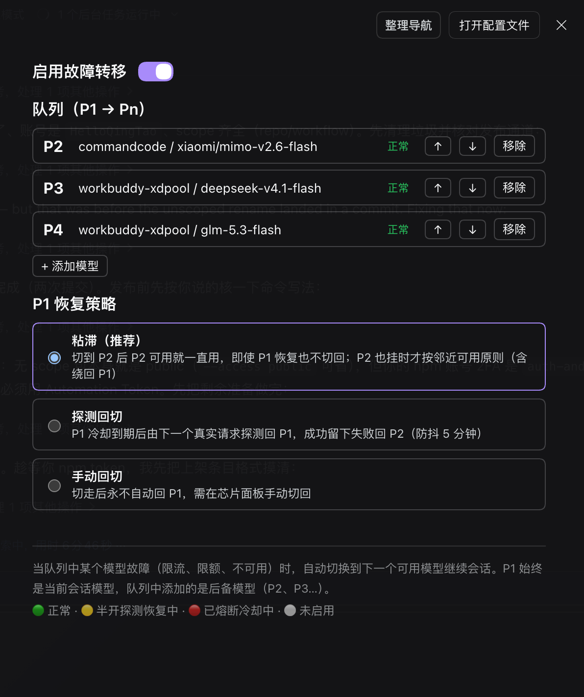
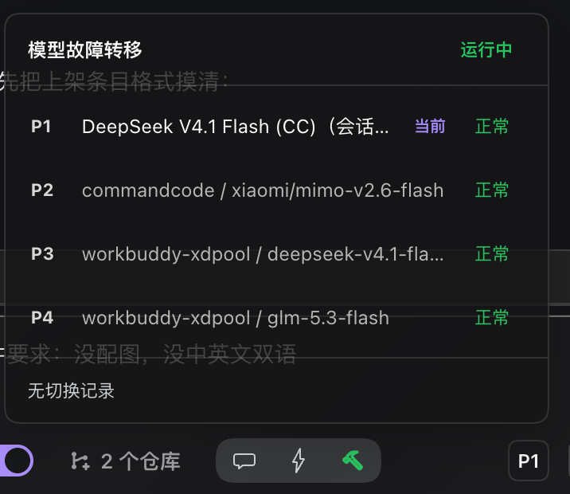

# dsh-model-fallback-queue

<p align="center">
  <a href="https://www.npmjs.com/package/dsh-model-fallback-queue"></a>
  <a href="https://www.npmjs.com/package/dsh-model-fallback-queue"></a>
  <a href="LICENSE"></a>
  <a href="https://github.com/HelloQingTao/dsh-model-fallback-queue/stargazers"></a>
  <a href="https://github.com/awesome-dsh-plugin/awesome-dsh-plugin"></a>
</p>

**English** | [中文](#中文)

---

## 中文

当前模型限额、限流或不可用时，自动切到队列里的下一个模型，把会话接着跑完。开关、队列、P1 恢复策略都在设置页里点，不需要命令行。

### 功能

- **请求级自动切换**：命中熔断码立刻熔断当前路由；非即时错误连续失败 2 次也熔断。
- **队列 P1 → Pn**：P1 默认跟随当前会话模型（你在模型选择器里换，P1 跟着换），队列里加的是后备 P2、P3…
- **三档 P1 恢复策略**：粘滞（默认）/ 探测回切 / 手动回切。
- **输入框状态芯片**：显示当前生效路由与健康状态，全熔断时是红色「全部熔断」徽章；展开是队列面板，可「切回 P1」或跳到设置页。
- **全熔断降级放行**：所有路由都不可用时按原配置放行，插件不拦截请求。
- **不抢同路由重试的活**：非致命错误一律放行，退避重试仍由 dsh-llm-retry 负责。
- **界面中英双语**：所有界面文案跟随 DSH 的语言设置，自动在中文 / English 之间切换。

### 效果图

设置页（开关 / 队列 / P1 恢复策略）：



输入框右侧的芯片与展开面板：



### 安装

```sh
dsh plugin --profile web add dsh-model-fallback-queue
```

装完重启 dsh（或刷新 Web GUI），bundle 会随包里的 `cordis.patch.yml` 自动注册。

### 用法

1. **设置 → 故障转移** → 打开「启用故障转移」。
2. **+ 添加模型**：挑后备模型（P2、P3…），↑ / ↓ 调顺序，「移除」删掉。
3. **P1 恢复策略**：选粘滞 / 探测回切 / 手动回切。
4. 回到会话：输入框右侧出现芯片，显示当前生效的 P1 路由。

发生切换时，会话里会出现核心自带的「模型已切换」通知，芯片同步切到新路由。

**芯片状态**

| 显示 | 含义 |
| --- | --- |
| `P1` + 绿点 | 正常走 P1 |
| `P2`（黄点） | 已切到 P2；黄点表示半开探测中 |
| `P!` + 红点 | 队列全部熔断，已降级放行原配置 |
| `P`（灰点） | 插件未启用 |

**恢复策略三档**

| 档位 | 行为 |
| --- | --- |
| **粘滞**（默认） | 切到 P2 后只要 P2 可用就一直用，P1 恢复也不切回；P2 也挂时按邻近可用往后找，绕回 P1 是最后手段。 |
| **探测回切** | P1 冷却到期后，由下一个真实请求探测回 P1；成功留下，失败回 P2（防抖 5 分钟，不发额外探测流量）。 |
| **手动回切** | 切走后不自动回 P1，用芯片面板里的「切回 P1」恢复。 |

### 配置项

| 字段 | 默认值 | 说明 | 设置页可改 |
| --- | --- | --- | --- |
| `enabled` | `false` | 总开关 | ✅ |
| `queue` | `[]` | 后备队列，数组顺序即优先级（存在 `~/.dsh/fallback-queue-state.json`，不在 settings 里，见下方说明） | ✅ |
| `failbackMode` | `sticky` | `sticky` / `probe` / `manual` | ✅ |
| `p1Follow` | `true` | P1 跟随当前会话模型 | — |
| `immediateCodes` | `QUOTA`、`ACCOUNT_QUOTA`、`RATE_LIMIT`、`AUTH`、`INVALID_CREDENTIAL`、`NO_ADAPTER` | 命中即熔断的错误码 | — |
| `failureThreshold` | `2` | 非即时码的连续失败阈值 | — |
| `cooldownMs` | `60000` | 熔断冷却毫秒 | — |
| `failbackDelayMs` | `300000` | 探测回切防抖毫秒 | — |

日常用的开关、队列、恢复策略都在设置页；标「—」的高级旋钮默认值适用于绝大多数场景，需要时写进 `~/.dsh/profiles/<profile>/cordis.patch.yml` 里本插件那一行的 `config`。

**为什么队列不放在 settings 里**：DSH 的 `ui-theme` 只要你写一次 settings 文档，就会重推一次主题快照，前端随之把整页 design token 逐个移除再写回，深色模式下会闪一帧白。队列排序是高频操作（反复点上下箭头调优先级），放在 settings 里每点一次闪一次；改存独立的 JSON 文件就完全不碰 settings revision，白闪消失。

队列文件是插件私有数据，**不在设置页的配置导出/备份范围内**，换机器需要重新排序。首次升级时如果文件不存在，会自动把 settings 里的旧队列迁移过来，所以已有配置不会丢。

### 兼容与注意

- 实测 dsh `0.2.0-rc.2`、`0.2.1-rc.2`（宿主 + Web GUI）。
- 兼容范围以 `package.json` 的 `engines.dsh` 为准（当前 `>=0.2.0-rc.2 <0.3.0`）。
- 与 `dsh-client-auto-continue` 天然兼容：自动续发走同一条请求瀑布，一样享受队列切换。
- 与 `dsh-llm-retry` 分层：它管同路由退避重试，本插件管跨路由切换。
- 号池类 provider（如 workbuddy-xdpool）单号限流由号池内部换号，整池到顶才轮到本插件跨模型切换。
- 熔断态是内存态，进程重启归零；不写文件、不动 session。
- 队列为空或只有一项时不会发生切换。
- 不要和其他故障转移插件同时启用，两个插件争抢同一错误事件没有意义。

### 许可证

[MIT](LICENSE)

---

## English

When your current model hits its quota, gets rate-limited or becomes unavailable, requests automatically fail over to the next model in your queue and the session keeps going. The switch, the queue and the P1 recovery mode are all configured from the Settings UI — no CLI needed.

### Features

- **Per-request failover.** Known failure codes trip the current route immediately; two consecutive failures of any other kind also trip it.
- **Queue P1 → Pn.** P1 follows the current session model by default (switch models in the picker and P1 follows); entries you add are the backups P2, P3…
- **Three P1 recovery modes.** Sticky (default), probe-back, manual.
- **Input-box status chip.** Shows the active route and its health, a red “all tripped” badge when nothing is left; expand it for the queue panel with a “Back to P1” action and a settings shortcut.
- **Degrades safely.** When every route is tripped the original config is passed through untouched — the plugin never blocks a request.
- **Does not fight same-route retries.** Non-fatal errors are always passed through; backoff retries stay with dsh-llm-retry.
- **Bilingual UI.** Every label follows the DSH language setting and switches between 中文 and English automatically.

### Screenshots

Settings page (switch / queue / P1 recovery mode):


The chip next to the input box and its expanded panel:


### Install

```sh
dsh plugin --profile web add dsh-model-fallback-queue
```

Restart dsh (or reload the Web GUI); the bundle registers itself through the `cordis.patch.yml` shipped in the package.

### Usage

1. **Settings → Failover** → turn on “Enable failover”.
2. **+ Add model** to add backups (P2, P3…); reorder with ↑ / ↓, remove with the remove action.
3. Pick a P1 recovery mode.
4. Back in the conversation, the chip next to the input box shows the active P1 route.

On every switch the core “model switched” notice appears in the session and the chip follows.

**Chip states**

| Chip | Meaning |
| --- | --- |
| `P1` green dot | Running on P1 |
| `P2` amber dot | Switched to P2; amber means a half-open probe is in flight |
| `P!` red dot | Every route tripped — original config passed through |
| `P` grey dot | Plugin disabled |

**Recovery modes**

| Mode | Behaviour |
| --- | --- |
| **Sticky** (default) | Once on P2 it stays there while P2 works, even after P1 recovers; if P2 also fails it walks forward and only wraps back to P1 as a last resort. |
| **Probe back** | After P1's cooldown expires the next real request probes P1; success keeps it, failure returns to P2 (5-minute debounce, no extra probe traffic). |
| **Manual** | Never returns to P1 automatically — use “Back to P1” in the chip panel. |

### Configuration

| Field | Default | Description | In Settings UI |
| --- | --- | --- | --- |
| `enabled` | `false` | Master switch | ✅ |
| `queue` | `[]` | Backups; array order = priority (stored in `~/.dsh/fallback-queue-state.json`, not in settings — see below) | ✅ |
| `failbackMode` | `sticky` | `sticky` / `probe` / `manual` | ✅ |
| `p1Follow` | `true` | P1 follows the current session model | — |
| `immediateCodes` | `QUOTA`, `ACCOUNT_QUOTA`, `RATE_LIMIT`, `AUTH`, `INVALID_CREDENTIAL`, `NO_ADAPTER` | Codes that trip a route immediately | — |
| `failureThreshold` | `2` | Consecutive failures for a soft trip | — |
| `cooldownMs` | `60000` | Circuit cooldown in ms | — |
| `failbackDelayMs` | `300000` | Probe-back debounce in ms | — |

The everyday switch, queue and recovery mode live in the Settings UI; the advanced knobs marked “—” keep sensible defaults and can be set in the plugin row's `config` inside `~/.dsh/profiles/<profile>/cordis.patch.yml`.

**Why the queue is not in settings**: any write to a DSH settings document makes `ui-theme` republish the theme snapshot, and the client then removes and rewrites every design token for the whole page — in dark mode that shows up as a one-frame white flash. Reordering the queue is frequent (you keep clicking the up/down arrows), so keeping it in settings meant a flash per click. Storing it in a standalone JSON file never touches the settings revision, and the flash is gone.

That file is plugin-private data and is **outside the Settings UI's config export/backup**, so ordering must be redone on another machine. On the first upgrade, if the file is missing, the old queue in settings is migrated automatically — existing configuration is not lost.

### Compatibility & notes

- Tested with dsh `0.2.0-rc.2` and `0.2.1-rc.2` (host + Web GUI).
- The supported range is declared by `engines.dsh` in `package.json` (currently `>=0.2.0-rc.2 <0.3.0`).
- Works alongside `dsh-client-auto-continue`: auto-continue rides the same request waterfall, so it benefits from failover too.
- Layered with `dsh-llm-retry`: it handles same-route backoff, this plugin handles cross-route failover.
- For pool-style providers (e.g. workbuddy-xdpool) a single account's rate limit is handled inside the pool; this plugin only switches models once the whole pool is exhausted.
- Breaker state is in memory and resets on restart; the plugin writes no files and never touches the session.
- No switching happens with an empty or single-entry queue.
- Do not run another failover plugin at the same time — two plugins competing for the same error event is not useful.

### License

[MIT](LICENSE)
